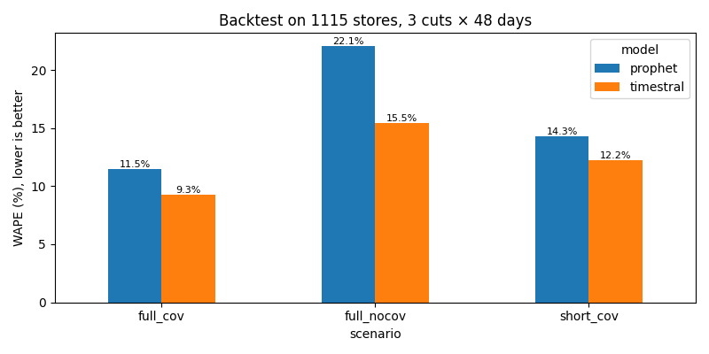
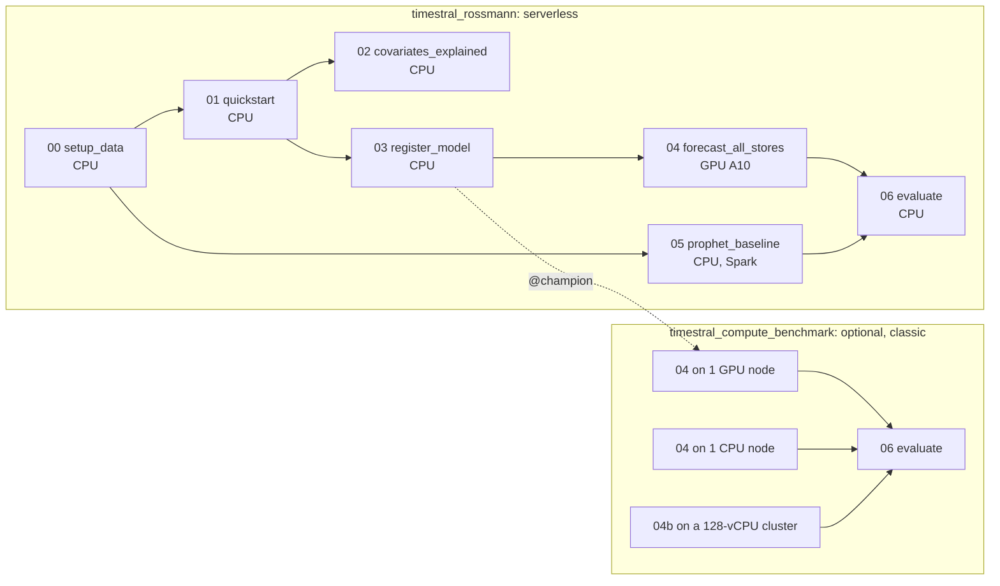
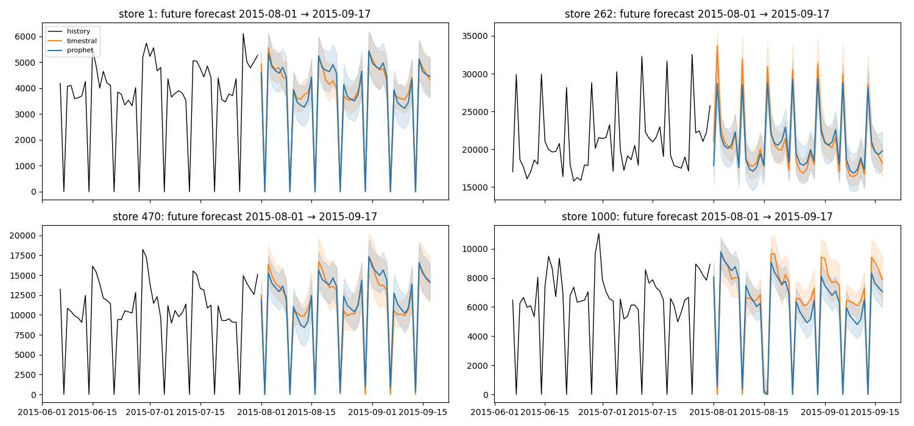

# Timestral on Databricks: zero-shot sales forecasting, governed end to end

Forecast the daily sales of **1,115 Rossmann stores** with [Timestral](https://github.com/mistralai/timestral), Mistral AI's
time-series foundation model, and compare it with a Prophet model fitted per store. On Databricks: data, weights,
model and forecasts in **Unity Catalog**, runs compared in **MLflow**, Timestral on **serverless GPU**, everything deployed
with a **Declarative Automation Bundle**.

**Result on 1,115 stores** (backtest, 3 forecast dates × 48 days; zero-shot Timestral vs Prophet fitted per store):

| | Prophet | **Timestral** | Timestral wins on |
|---|---|---|---|
| Full history + calendar covariates | 11.5% WAPE | **9.3% WAPE** | **97%** of stores |
| No covariates | 22.1% | **15.5%** | 99.8% |
| New store (last 90 days only) | 14.3% | **12.2%** | 81% |



The whole pipeline (data, model registration, both models on every store, evaluation) runs in about 10 minutes on
serverless; Timestral forecasts all stores in 3.5 minutes on one serverless A10 GPU. Read the [caveats](#caveats).

---

## Contents

1. [The story](#the-story)
2. [Learning path: the notebooks](#learning-path-the-notebooks)
3. [Quickstart](#quickstart)
4. [How covariates work](#how-covariates-work)
5. [From files to a governed model](#from-files-to-a-governed-model)
6. [Timestral vs Prophet: method](#timestral-vs-prophet-method)
7. [Results](#results)
8. [Compute options](#compute-options)
9. [Caveats](#caveats)
10. [Repository layout](#repository-layout)
11. [Acknowledgements](#acknowledgements)
12. [License](#license)

---

## The story

1. **A foundation model against per-store training.** Prophet needs one model per store to fit, tune and monitor;
   Timestral is one pretrained model, no training. On this dataset it is also more accurate.
2. **Known-future covariates are what make it work.** Telling the model "the store is closed on Sunday, there is a
   promotion next week" cuts its error by 40% (15.5% → 9.3% WAPE).
3. **Databricks makes it production-grade.** Data, weights, the registered model (`@champion`) and the forecasts live in
   Unity Catalog; every forecast row points to its model version and MLflow run; Timestral runs on serverless GPU with
   no cluster to manage; the forecasts sit next to the data, ready for a dashboard or Genie.

## Learning path: the notebooks

Start simple, then productionize:

| # | notebook | level | Timestral loaded from |
|---|---|---|---|
| 00 | [`setup_data`](src/notebooks/00_setup_data.py): Rossmann CSV → `raw` volume → UC tables | | |
| 01 | [`quickstart`](src/notebooks/01_quickstart.py): download the weights, forecast one store in a few lines | beginner | the volume, `TimestralForecaster.from_pretrained` |
| 02 | [`covariates_explained`](src/notebooks/02_covariates_explained.py): target, known-future, past-only and categorical covariates on one store | beginner | the volume |
| 03 | [`register_model`](src/notebooks/03_register_model.py): wrap as an MLflow model, register in UC, set `@champion` | production | |
| 04 | [`forecast_all_stores`](src/notebooks/04_forecast_all_stores.py): backtest + future forecast of every store | production | `models:/<catalog>.<schema>.timestral@champion` |
| 05 | [`prophet_baseline`](src/notebooks/05_prophet_baseline.py): the same forecasts with Prophet, one model per store, Spark `applyInPandas` | baseline | |
| 06 | [`evaluate`](src/notebooks/06_evaluate.py): metrics, MLflow, the `sales_with_forecasts` view | | |
| 04b | [`forecast_cpu_cluster`](src/notebooks/04b_forecast_cpu_cluster.py): Timestral spread over a CPU cluster (benchmark job) | optional | `@champion` |

Two jobs:



## Quickstart

Prerequisites:

* a Databricks workspace with Unity Catalog, **serverless compute** and **serverless GPU** (AI Runtime);
* the workspace preview **"Serverless workspace base environment support in Jobs"** (Beta at the time of writing,
  enabled by a workspace admin on the **Previews** page). Without it, change the `serverless_gpu` environment in
  [`resources/timestral_rossmann.job.yml`](resources/timestral_rossmann.job.yml) to `environment_version: "6"` and add
  `torch` to its dependencies;
* `USE CATALOG` and `CREATE SCHEMA` on a catalog (the bundle creates the schema, two volumes, the tables and the model);
* the [Databricks CLI](https://docs.databricks.com/dev-tools/cli/) locally.

```bash
git clone https://github.com/florent-brosse/timestral-databricks.git && cd timestral-databricks
databricks auth login --host https://<your-workspace>.cloud.databricks.com --profile <profile>

databricks bundle deploy -p <profile> --var catalog=<catalog>
databricks bundle run timestral_rossmann -p <profile> --var catalog=<catalog>                    # all 1,115 stores
databricks bundle run timestral_rossmann -p <profile> --var catalog=<catalog> --params max_stores=50  # quick run
```

In the `dev` target the bundle runs in development mode: the schema is prefixed (`dev_<user>_timestral_forecast`) and
the jobs are called `[dev <user>] …`. The notebooks also run interactively: open them in the workspace, set the widgets
(catalog, schema) and run.

**Job parameters**

| parameter | default | meaning |
|---|---|---|
| `catalog`, `schema` | from the bundle | where the schema, tables, volumes and model live |
| `model_id` | `mistralai/Timestral-209M` | any Timestral checkpoint: `-5M`, `-28M`, `-123M`, `-209M` |
| `horizon` | `48` | days to forecast (= the length of the Kaggle test period) |
| `n_cuts`, `cut_step_days` | `3`, `28` | backtest: 3 forecast origins 4 weeks apart, the last one ending on the last day of history |
| `short_history_days` | `90` | context length of the `short_cov` scenario |
| `max_stores` | `0` | `0` = all stores |
| `experiment_name` | `/Users/<you>/timestral_rossmann` | MLflow experiment |

## How covariates work

Timestral forecasts a **target** from its past and can condition on **covariates**: series that explain the target.
Covariates are never forecast; information flows from covariates to targets only, and targets stay causal (no leak of
future sales).

| argument | shape | known over | in this repo |
|---|---|---|---|
| `context` | `(B, V, T)` | the past | daily sales (`V = 1`) |
| `known_covariates` | `(B, C, T + H)` | the past **and the forecast range** | `open`, `promo`, `school_holiday`, `public_holiday` |
| `past_covariates` | `(B, C, T)` | the past only | `customers` (notebook 02) |
| `categorical_known_covariates` | `(B, C, T + H)` | past and future, as codes | holiday type `0/a/b/c` (notebook 02) |

`B` = series in the batch, `T` = context length, `H` = `prediction_length`.

**Yes, the covariates must be given for the forecast range.** That is what "known-future" means: you know today that the
store is closed next Sunday and runs a promotion next week. Timestral checks that `known_covariates` covers `T + H` steps.
In production the future values come from the store calendar; here from Kaggle's `test.csv` (the `future_covariates`
table). Unknown future values can be `NaN`. A driver only known after the fact (customers) goes in `past_covariates`.

```python
target = cube["sales"][rows, None, s0:c]                            # (B, 1, T): sales before the cut
known = np.stack([cube[k][rows, s0:c + H] for k in COV_KEYS], 1)    # (B, 4, T + H): calendar incl. the next H days
fc = forecaster.forecast(target, prediction_length=H, known_covariates=known)
fc.quantiles   # (B, 1, H, 21): quantile levels 0.01 … 0.99
fc.median      # (B, 1, H): the point forecast
```

Rows containing only 0 and 1 are treated as indicators (all four of ours). `NaN` means missing: the 180 stores without
data for 2014-07 → 2014-12 are passed as they are.

## From files to a governed model

Notebooks 01-02 use the checkpoint as plain files in the `models` volume. Notebook 03 turns it into a **Unity Catalog
model**:

* [`timestral_model.py`](src/notebooks/timestral_model.py): a small `mlflow.pyfunc.PythonModel` (MLflow
  [models-from-code](https://mlflow.org/docs/latest/ml/model/models-from-code/)). `predict()` takes a long DataFrame
  (`series_id`, `ds`, `y` with NaN on the days to forecast, covariate columns), so the model works with `spark_udf` or
  Model Serving; `unwrap_python_model().forecaster` exposes the native `TimestralForecaster` for batched calls;
* the checkpoint as an MLflow **artifact**, the pinned Timestral source as **`code_paths`**;
* an explicit signature, so registration runs on CPU without PyTorch (about 30 s);
* registered as `<catalog>.<schema>.timestral`, tagged with the Hugging Face revision and the Timestral commit, alias
  **`@champion`**. It is re-registered only when one of them changes.

Notebook 04 resolves `@champion`, downloads that version once to the volume, and every forecast row records it in
`model_version`. Switching checkpoints (`-28M` → `-209M`) = register a new version and move the alias; no code change.

Docs: [Manage models in Unity Catalog](https://docs.databricks.com/machine-learning/manage-model-lifecycle/) ·
[aliases](https://docs.databricks.com/aws/en/machine-learning/manage-model-lifecycle/#use-model-aliases) ·
[batch inference](https://docs.databricks.com/machine-learning/model-inference/).

**Why Timestral is not `pip install`-ed.** It is pure Python and not on PyPI. Instead of building it from GitHub on
every run, `common.use_timestral()` downloads the source once, at a pinned commit, into the `models` volume and adds it
to `sys.path`; the registered model then carries it as `code_paths`, so it works on any compute without a build step.

**Where everything lives**

```
<catalog>.<schema>
├── raw (volume)                 train.csv, test.csv, store.csv
├── models (volume)              mistralai__Timestral-209M/ (weights), timestral-src-<commit>/, registered/timestral-v<N>/
├── timestral (registered model) versions + @champion
├── sales_history                store, date, sales, customers, open, promo, school_holiday, public_holiday, state_holiday
├── future_covariates            the 48 days to forecast (no sales)
├── stores                       store attributes
├── forecasts                    model, model_version, scenario, forecast_type, cut_date, store, date, horizon_day,
│                                q10, q50, q90, quantiles[21], mlflow_run_id, created_at (partitioned by model)
├── backtest_metrics             model, scenario, cut_date, wape_pct, wape_open_pct, mae, coverage_80, stores, win_rate
└── sales_with_forecasts (view)  history + the future forecasts of both models, one row per store and day
```

## Timestral vs Prophet: method

Same data, same cut dates, same horizon, same covariates:

| | Timestral | Prophet |
|---|---|---|
| training | none (pretrained, zero-shot) | one fit per store, scenario and cut (11,150 fits) |
| covariates | `known_covariates` | `add_regressor` for each of the 4 columns |
| missing days | `NaN` | rows dropped |
| `short_cov` | last 90 days as context | last 90 days, yearly seasonality off |
| negative forecasts | clipped by the model | clipped at 0 (Prophet adds a negative "closed" effect to its baseline) |
| uncertainty | 21 quantiles; `q10`/`q90` stored | 80% interval (`interval_width=0.8`) as `q10`/`q90` |
| settings | defaults | defaults + the 4 regressors |
| compute | serverless GPU (A10), batches of 64 stores | serverless CPU, Spark `applyInPandas`, one store per group |

**Scenarios**

| scenario | history | covariates | question |
|---|---|---|---|
| `full_cov` | everything since 2013-01-01 | the 4 known-future columns | the production setup |
| `full_nocov` | everything | none | what if there is no calendar? |
| `short_cov` | last 90 days | the 4 columns | a new store or product |

**Metrics** on the backtest (3 cut dates × 48 days, every store):

* **WAPE** = Σ|forecast − actual| / Σ actual: the error as a share of sales, fair across store sizes;
* **WAPE, open days**: the same on days the store is open. Closed days (sales = 0) are easy once `open` is known, so
  this is the stricter number (the Kaggle competition also scored open days only);
* **MAE** in € per store-day;
* **80% coverage**: share of days where the actual falls in `[q10, q90]`; well calibrated ≈ 0.80;
* **win rate**: share of stores where the model has the lower total error (Timestral vs Prophet).

**MLflow.** Each model run is a parent run (parameters, model version, runtime) with one child run per scenario;
notebook 06 logs the metrics into the child runs (per-cut WAPE as a step series), and a `comparison` run keeps the
summary table and the charts. Every forecast row stores its child run id in `mlflow_run_id`. Select the scenario runs
in the experiment and use **Compare**.

## Results

Run of the main job on all 1,115 stores: cut dates 2015-04-19, 2015-05-17 and 2015-06-14, 48 days each, Timestral-209M
version 1 `@champion`. Numbers from the `backtest_metrics` table and the MLflow `comparison` run.

| scenario | model | WAPE | WAPE, open days | MAE (€/day) | 80% coverage | wins on |
|---|---|---|---|---|---|---|
| `full_cov` | Prophet | 11.5% | 10.5% | 689 | 0.82 | 3% |
| | **Timestral** | **9.3%** | **9.1%** | **556** | 0.87 | **97%** |
| `full_nocov` | Prophet | 22.1% | 17.4% | 1,325 | 0.86 | 0.2% |
| | **Timestral** | **15.5%** | **11.2%** | **928** | 0.90 | **99.8%** |
| `short_cov` | Prophet | 14.3% | 13.1% | 856 | **0.71** | 19% |
| | **Timestral** | **12.2%** | **10.5%** | **732** | 0.88 | **81%** |

What it says:

* **More accurate on almost every store.** With the calendar, Timestral's error is 19% lower than Prophet's (13% on
  open days only) and it wins on 97% of the stores, with no training.
* **The covariates matter most for Timestral.** Without them its error goes from 9.3% to 15.5%; Prophet without them is at
  22.1%.
* **Short history: the uncertainty is where the difference is.** With 90 days, Prophet's 80% bands contain the actual
  value only 71% of the time; Timestral's stay reliable (88%), which matters for safety stock.
* **Timestral's bands are a bit wide** (87-90% coverage for a nominal 80%): conservative rather than overconfident.

| runtime, 1,115 stores, all 10 forecasts per store | |
|---|---|
| Timestral on serverless GPU (1× A10) | 211 s |
| Prophet on serverless CPU (11,150 fits, Spark `applyInPandas`) | 360 s |
| whole main job (7 tasks) | about 9 minutes |

`runtime_s` in MLflow includes writing the 522,768 forecast rows to Delta.



## Compute options

The forecasts do not depend on the compute: the same model version gives the same numbers on GPU and CPU. The
optional `timestral_compute_benchmark` job measures the runtime of the alternatives (AWS node types; change them on
Azure or GCP):

| Timestral on all 1,115 stores (10 forecasts each) | compute | `runtime_s` | compute startup |
|---|---|---|---|
| main job (`timestral`) | serverless GPU, 1× A10 | 211 s | seconds |
| `timestral_classic_gpu` | 1 × `g5.2xlarge` (1× A10G, 8 vCPU) | 192 s | ~12 min |
| `timestral_cpu_cluster` | 4 × `m6id.8xlarge` (128 vCPU), notebook 04b | 513 s | ~6 min |
| `timestral_classic_cpu` | 1 × `m6id.8xlarge` (32 vCPU, no GPU) | 1,618 s | ~6 min |
| Prophet, for reference | serverless CPU, 11,150 fits | 360 s | seconds |

**Same model version, same forecasts, whatever the compute.** Notebook 06 compares every forecast of each variant with
the same forecast of the serverless GPU run (same store, day, scenario and cut date):

| variant vs serverless GPU | rows compared | largest median difference | average median difference | average forecast |
|---|---|---|---|---|
| classic GPU (A10G) | 522,768 | 0.14 € | 0.001 € | 5,978 € |
| 1 CPU node | 522,768 | 0.12 € | 0.001 € | 5,978 € |
| CPU cluster (Spark UDF) | 522,768 | 0.12 € | 0.001 € | 5,978 € |

The differences are floating-point noise between GPU and CPU kernels (float32), so the metrics match to the 6th
decimal (9.2721% WAPE in `full_cov` for all four). Choose the compute for speed and cost, not for results: serverless
GPU gives about the speed of a dedicated GPU node without its startup time.

Classic clusters: Databricks Runtime 18 LTS ML.

Notes:

* **Timestral wants a GPU and big batches.** One 837 MB model: load it once and push many series through it.
* **Covariates multiply the work.** Each covariate is an extra row in the model input: 4 covariates = 5× the rows.
* **Spreading Timestral over CPU workers** (notebook 04b) loads one copy of the 837 MB model per Spark task, so it is
  meant for classic clusters with large workers; on serverless, use the GPU path (notebook 04).
* **Serverless environments.** The standard environments (`environment_version: "1"`–`"6"`) have no PyTorch. On GPU,
  the AI environment (`workspace-base-environments/databricks_ai_v6`) has PyTorch + CUDA, `huggingface_hub`,
  `safetensors` and `transformers` preinstalled. Notebooks 01-02 run on serverless CPU and install the CPU build of
  PyTorch when it is missing. Use environment version `6` or later: version 4 ships MLflow 2, and the registration
  notebook needs MLflow 3.
* **Apple Silicon (local development).** Timestral computes its normalisation statistics in `float64`, which PyTorch's
  MPS backend does not support. The community fork
  [paschembri/timestral@mps-support](https://github.com/paschembri/timestral/tree/mps-support) runs those steps on the
  CPU; in our tests MPS was about 1.75× faster than CPU with identical forecasts.

## Caveats

* **Possible overlap with Timestral's training data.** Rossmann is part of [fev-bench](https://github.com/autogluon/fev),
  one of the benchmarks Timestral is evaluated on, and Mistral has not yet published the list of real datasets used in
  pretraining (most of it is synthetic; a technical report is announced). Read the results as "likely zero-shot".
* **Prophet runs with default settings** plus the regressors. Tuning (changepoints, holidays, seasonality priors) would
  narrow the gap: the comparison is zero-shot vs default, not vs a tuned model.
* **`open` is almost the answer on closed days.** `open = 0` means `sales = 0`. It is legitimate known-future information
  (the store schedule), which is why the open-days WAPE is reported too.
* **One dataset, three cut dates.** A strong case study, not a general benchmark.

## Repository layout

```
├── databricks.yml                          bundle: variables, dev target
├── resources/
│   ├── timestral.schema.yml                UC schema
│   ├── raw.volume.yml, models.volume.yml   UC volumes
│   ├── timestral_rossmann.job.yml          main job, serverless (CPU + one GPU task)
│   └── timestral_compute_benchmark.job.yml optional job, classic GPU / CPU / CPU cluster
└── src/notebooks/
    ├── 00_ … 06_ notebooks
    ├── common.py                           config, Timestral loading, forecasting functions, MLflow + save
    └── timestral_model.py                  the MLflow pyfunc registered in Unity Catalog
```

## Acknowledgements

* **[Timestral](https://github.com/mistralai/timestral)** by [Mistral AI](https://mistral.ai): the model and the
  inference library. See the [announcement](https://mistral.ai/news/timestral/) and the
  [model cards](https://huggingface.co/collections/mistralai/timestral). The code is Apache 2.0; the weights
  ([Timestral-5M](https://huggingface.co/mistralai/Timestral-5M), [-28M](https://huggingface.co/mistralai/Timestral-28M),
  [-123M](https://huggingface.co/mistralai/Timestral-123M), [-209M](https://huggingface.co/mistralai/Timestral-209M)) are
  released under a [Modified MIT license](https://huggingface.co/mistralai/Timestral-209M/blob/main/LICENSE). This
  repository pins upstream commit
  [`a534bdb`](https://github.com/mistralai/timestral/commit/a534bdbd244d64f3d9d743f46c7bf6fc330ed4ff).
* **[Rossmann Store Sales](https://www.kaggle.com/c/rossmann-store-sales)**: the dataset, from the Kaggle competition
  hosted by Rossmann. The notebooks download a public copy from the Hugging Face Hub,
  [`AiiN-aini/rossmann-store-sales`](https://huggingface.co/datasets/AiiN-aini/rossmann-store-sales); the data is not
  redistributed here. Check the [competition rules](https://www.kaggle.com/c/rossmann-store-sales/rules) before reusing
  it. The same dataset is part of [fev-bench](https://github.com/autogluon/fev)
  ([`autogluon/fev_datasets`](https://huggingface.co/datasets/autogluon/fev_datasets)).
* **[Prophet](https://facebook.github.io/prophet/)** ([GitHub](https://github.com/facebook/prophet)) by Meta's Core Data
  Science team: the baseline.
* **[paschembri/timestral](https://github.com/paschembri/timestral/tree/mps-support)**: Apple MPS support for local runs.
* Built on [Databricks](https://www.databricks.com/) Unity Catalog, serverless compute and AI Runtime, MLflow and
  [Declarative Automation Bundles](https://docs.databricks.com/dev-tools/bundles/).

## License

The code in this repository is released under the [Apache License 2.0](LICENSE). Timestral, its weights, Prophet and the
Rossmann data keep their own licenses and terms (see [Acknowledgements](#acknowledgements)).
